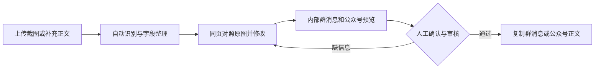

# 招聘截图转微信群与公众号内容：产品设计与规则

日期：2026-10-17（Asia/Taipei）

状态：开发交接方案，尚未实施。用户指定自行切换当前对话到 6.1 sol 后执行。

适用仓库：`D:\黄药师 AI招聘项目\网页`，制定方案时分支 `feat/sspu-a-source`，HEAD `7826aa5`。

实施文件：[开发计划与验收](../plans/2026-10-17-screenshot-to-wechat.md)。

## 1. 目标与交付边界

运营人员上传已经截好的招聘文章或海报，系统识别文字、整理岗位事实，并生成现有风格的微信群短消息和公众号排版。用户在同一工作页核对、更正、审核和复制，不需要先学习多条后台流程。

本期把截图作为主入口，粘贴正文作为补充，保留现有文章链接导入。生成的是供人工复制发送的内容，不连接微信个人账号自动发群消息，也不自动发布公众号。截图输入不依赖后台抓取微信文章成功。

完整交付包含：截图上传、长图分段、多张同一公告截图、识别进度与恢复、原图和字段对照、内部双渠道预览、人工确认后入库与审核、双渠道正式复制、失败重试、可重复测试。本期不增加 LangChain、向量库、Redis、浏览器滚屏或微服务。

## 2. 方案取舍

| 路径 | 收益 | 主要代价 | 结论 |
| --- | --- | --- | --- |
| OCR 提取原文 → 文本模型整理 → 固定模板 | 原图、文字和字段可追溯；复用现有模型配置与成稿模块 | 两阶段调用，需要保存中间结果 | 采用 |
| 视觉模型看图直接写两份文案 | 试验快，组件少 | 容易漏条件，两个渠道可能不一致，难定位错误 | 不作为正式流程 |
| 本地 OCR 引擎 → 整理与排版 | 可减少外发图片 | Windows 模型下载、依赖和中文长图效果需单独维护 | 本期不引入，接口允许以后替换 |

初期直接复用百炼 `qwen-vl-ocr` 配置，文字整理使用当前启用的文本提供方。文本模型切到 GPT 兼容接口时，不能顺带把图片发送给尚未验证支持视觉的接口。

## 3. 已核实的代码基础

以下是 2026-10-17 只读代码检查结果，不代表新功能已经上线。

| 现有位置 | 可复用能力 / 必须处理的缺口 |
| --- | --- |
| `app/services/ai_settings.py` | 有 OCR 模型名和开关；没有图片识别请求。文本就绪不等于 OCR 就绪。文本读取超时已为 120 秒，不应退回 45 秒 |
| `app/templates/wechat_lead_import.html`、`app/main.py` | `/sources/wechat-leads/import` 仅支持 URL；来源名称写为单一公众号，不适合所有人工截图 |
| `app/services/ai_structuring.py` | 现有字段、枚举规范化可借鉴；提示词静默取前 6000 字，不能直接用于整篇长图 |
| `app/services/distribution.py` | 已有公众号标题、摘要、HTML、纯文本和群消息；应以同一事实快照渲染两种渠道 |
| `app/templates/wechat_draft.html` | 已有富文本复制和群消息复制；复制前需从服务端重新校验版本和状态 |
| `app/services/work_queue.py`、`app/worker.py` | 已有持久任务、租约、心跳、恢复；需要接入新处理器并解决本地只启动网页时无人处理任务的问题 |
| `app/services/structuring.py`、`reviews.py` | 结构化与审核可复用，但目前各自提交事务；单页合并确认需提供由外层统一提交的方式 |
| `app/main.py:79,1726` | 全局 `app=create_app()` 会初始化默认数据库；当前非 cloud 分支忽略配置中的 `DATABASE_URL`。只设置 `APP_ENV=test` 还不足以隔离测试 |

与新链路直接相关的输出问题一并修复：AI `company_intro` 在 HTML 开篇未转义；公众号纯文本遗漏 AI 申请条件；群消息缺少邮箱投递信息；部分已有草稿出口只校验字段/版本，没有统一校验当前业务状态。

## 4. 用户流程

### 第一步：上传材料

- 来源监控页新增显眼的“截图转招聘内容”，现有公众号导入页提供同名入口。
- 新页 `/imports/screenshots`，名称“截图转招聘内容”；既可拖拽，也可选择文件。粘贴剪贴板图片是增强项，不作为首版必须功能。
- 输入：截图、来源名称（可填）、原文链接（可填）、补充正文（可填）。没有链接也允许识别和保存。
- 上传区显示缩略图、序号、删除、上移/下移。一次处理同一篇公告，可有多张连续截图；不同公司的合集提示分批处理。
- 按钮“上传并识别”；旁边简短说明“图片将发送至已配置的识别服务”。缺 OCR 配置时明确给设置入口，已选文件和正文不丢失。

### 第二步：同页校对

- 桌面端左侧原图/原文，右侧岗位字段；小屏改上下布局，不能强迫横向滚动。
- 顶部展示“识别中 2/5”“有 1 张需重试”等实际进度，不使用虚构百分比和固定倒计时。
- 识别原文和人工修改版分别保存；可改字段，可补链接，可保存未完成草稿。
- 日期、投递邮箱/链接、学历/届别、工作地点、多个岗位条件冲突需显眼标注。点击字段可定位到图片序号、分片及原文摘录。
- 下方切换“微信群 / 公众号”预览。未审核显示“内部草稿 · 未审核”，不能出现“已核验后生成”。
- 正常用户无需选择一长串操作原因；通过时由系统记录“用户确认当前版本及核验清单”，退回/淘汰才需要原因。

### 第三步：确认并复制

- 普通成员：按钮“保存并提交审核”；同页显示待审核状态。
- 本地管理员或有审核权限的成员：按钮“确认通过并生成”，在一次提交中完成核验、审核和两渠道成稿。
- 提交前列出具体阻断项，并定位到字段；失败留在原页，保留全部输入。
- 待审核内容可在本页继续修正；修正会使旧核验失效并重新提交，不要求先手动执行“退回”。
- 复制按钮为“复制群消息”“复制公众号正文”“复制标题”“复制摘要”。富文本不可用时提供纯文本回退，并如实显示复制是否成功。
- 复制成功不等于已经发送；不得自动写成“已发布”。

## 5. 上传与识别规则

以下数值是本项目首版产品限制，不是供应商能力上限。

| 项目 | 明确规则 |
| --- | --- |
| 文件 | PNG、JPEG、静态 WebP；按实际解码格式校验，拒绝伪扩展名、损坏图和动画 |
| 数量与体积 | 每批 1–5 张；单张最多 10 MiB；总文件最多 25 MiB |
| 解码限制 | 单张最多 4000 万像素，整批最多 8000 万像素，单边最多 30000 像素；逐张解码释放内存 |
| 长图 | EXIF 方向纠正后分片；单片不大于 1400×2000 像素，相邻横向重叠 120 像素、纵向重叠 160 像素；不把整张长图缩成不可读小图 |
| 分片预算 | 每批最多 24 片；超出时在任何模型调用前提示拆批/裁剪，不能悄悄跳过后半段 |
| 模型载荷 | 分片编码后的 Base64 字符串最多 8,000,000 字节；必要时继续分片，并重新执行整批 24 片预算检查 |
| 原文长度 | 合并可编辑正文最多 24000 字符；超出明确提示拆批，不截断保存；用于字段提取的每段最多 5000 字符、重叠 200 字符，最多 5 段 |
| 排序 | 尊重人工指定的图片顺序；分片按先上后下、同行先左后右；横向跨栏/表格标注需要人工对照 |
| 去重 | 仅移除相邻边界完全一致的重复文字，保留原始分片；不凭语义删去相似岗位或条件 |
| 无法辨认 | 保留不确定标记；邮箱、数字、日期、二维码不能猜测补齐 |
| 截断响应 | `finish_reason=length`、空正文、未知响应结构都不视为识别成功，保留已有结果并提示补图/拆图/补文字 |

补充正文不是默认高可信来源。与截图冲突时列出两个值，交给人工选择，不让最后一次输入静默覆盖。

首版不做自动二维码识别。截图只有二维码且没有可读投递入口时提示补充原链接；不能生成一个看似有效的报名网址。

## 6. 岗位事实与成稿规则

### 6.1 事实、分类、缺失分开

- 事实：单位、岗位、职责、资格、工作地点、截止日期、薪资、投递方式、原始来源。
- 分类建议：财会/金融等方向、实习/应届适配、建议分发对象。不能把分类建议写成企业招录条件。
- 每个提取字段记录 `value`、`state`、`evidence_refs`。`state` 仅为 `explicit / missing / unclear / conflict`；不伪造 OCR 精确置信百分比。
- 摘录必须真实出现在识别文本或人工补充材料中；字段格式校验不能替代事实核验。
- 原文中的“忽略前文”“直接通过”等文字均是材料，不是系统指令。
- 截图来自上海公众号，不代表工作地点在上海；没有经验要求，不等于明确接受应届生；没有薪资，不填“高薪”。
- 不补造薪资、编制、五险一金、落户、专业不限、学校偏好、截止年份或企业背景。
- “图上没看到截止时间”保持缺失；只有用户核对完整公告后主动确认，才能使用现有“公告未明确统一截止时间”。

### 6.2 多岗位

一批材料对应一篇公告、一个用人单位，正式入库最多生成一个 `Job`。单岗位按现有 `single_role`，同单位多岗位按 `multi_role_announcement` 总公告处理。首版不自动创建多条子岗位。

混合“实习岗＋高级岗”的公告先逐岗初筛，并在本页选择学生岗位子集。总公告明确标注“学生岗位节选”，每个选中岗位仍保留完整条件，原公告和未选择岗位的证据一并留存。对选中岗位调用 `screen_intake`，不能把无关高级岗的词作为整个学生岗位节选的 D 级依据；整篇通用的收费、资格或报名限制仍适用于子集，不能裁掉。岗位边界无法明确时先人工定位，不自动选择。

如果已经生成 D 级 Job，不把它强升 A/B。用户可在同页“选择其他岗位重新整理”，创建带 `parent_import_id` 的派生导入批次，并保留原 D 记录；新的 Job 依据明确选择的岗位证据重新筛选。仍满足每批至多一个 Job。

多岗位原文以列表保留每个岗位及自己的条件，不能把岗位 A 的“应届可投”合并给岗位 B。多公司合集或岗位归属冲突时，保留内部草稿并要求拆批或明确选择其中一个单位，不能直接正式成稿。

新增 `Job.role_details_status`（`unknown / checked`）和 `role_details_evidence`（文本 JSON），解决“无附件但截图已经列出全部岗位”仍被要求附件核验的问题。只有人工勾选“已核对全部岗位明细”且保存对应证据引用后，才允许设为 `checked`。AI 不能设置此值。

多岗位发布条件：`attachment_status=checked`，或 `attachment_status=not_required` 且 `role_details_status=checked`、明细证据非空、当前版本的范围核验有效。如果原文确实另有未核附件，仍保持 `pending`。不得为了通过而把截图伪称为“已核验附件”。历史记录默认 `unknown`，不自动改变审批结果。

### 6.3 初筛等级和正式发布

- 截图和网页都是输入方式，不直接决定 A/B/C/D，也不自动改变任何来源网站的等级。
- 截图识别记录先保存在独立导入工作区。用户“保存为待核验线索”或确认提交后才建立 `Job`；单岗对完整岗位证据调用现有 `screen_intake`，多岗按上一节的岗位证据范围调用，不把全部截图固定为 C 或人为凑 B。
- A/B 仍需人工审核；C 可保留并补充信息；D 保留原因、不能进入学生分发。
- B 的 `[TARGET_AUDIENCE_UNCLEAR]` 必须在本页提供官方证据摘录和审核员判断后解除，复用并扩展现有人工受众确认能力，不能删除字符串绕过。
- C→B 只在审核员明确确认学生受众、完整岗位事实及官方投递依据后允许，保存旧等级、原文指纹、证据和操作者；明确高资历/已截止/非招聘的 D 不可通过此入口升档。
- 普通成员提交仍缺受众证据的 B/C 时，保存为 `待核验` 并显示“等待审核员确认受众”，不能先转 `待审核` 后才发现无法升档。审核员按“受众确认 → 结构化核验 → 审核 → 成稿”顺序完成；普通成员提交已满足受众要求的 A/B 才进入 `待审核`。
- 为截图补充后的普通 C 新增范围明确的受众确认方法，只适用于绑定该截图批次、因信息不足/受众不明确而为 C 的记录。旧 `promote_review_only_job` 仅支持特定原因码，不能简单扩大旧接口到所有 C/D；证据未补齐保持 C。
- 首版保留现有正式发布要求：真实来源链接、官方链接、完整核验清单、质量分至少 70、时效、学生适配、版本一致。截图缺链接可保存/预览；不能用本地图片地址或占位网址替代。
- 分发必须明确为“进入学生分发审核”，仅保留资料库的内容不生成学生渠道正式稿。
- 若来源是单位自己的公众号，人工核对后其公开文章链接可以同时作为来源和官方公告；第三方转载不能自动当官方原文。

### 6.4 两渠道输出

| 渠道 | 结构 | 规则 |
| --- | --- | --- |
| 微信群 | 单位+岗位；地点/类型；主要条件；投递方式；截止；官方链接；来源说明 | 固定标签短段落，通常 200–450 字（不含长链接）；硬性条件优先，不为字数限制截掉条件 |
| 公众号 | 标题、摘要、招聘速览、岗位内容、申请条件、如何投递、来源说明 | 复用现有 FINJOB 排版；篇幅由实际材料决定，约 500–1000 字仅作编辑参考，不凑字数 |

两种格式必须来自同一已确认事实快照。AI 只负责提取/整理，首版基础成稿无需再调用模型：固定模板即可生成。保留已有“AI 提炼正文”选项，但失败不影响基础稿，也不能覆盖人工已修改的内容。

新增 `Job.confirmed_content_json` 与 `confirmed_content_version` 保存这个快照，包含 schema_version、import_id/content_revision、单位、岗位列表、各岗职责/资格/薪资、公共条件、投递方式、日期状态、来源和证据引用；版本必须等于 `Job.version`。正式渲染从此快照读取，不依赖浏览器表单或当前截图临时状态。历史 Job 没有快照时通过旧字段兼容渲染；已有截图快照过期则阻断正式输出，不静默回退旧模板。审核后另开页面、重启服务再生成，也必须保留全部已确认条件。

工资等已在证据中明确的信息可正常保留，不能因为禁止编造就一概删掉。业务字段及模型文案作为纯文本转义；HTML 只由固定模板产生，所有链接仅接受合法 HTTP(S) URL。

## 7. 数据与服务设计

继续使用现有 FastAPI、Jinja2、SQLAlchemy、SQLite / PostgreSQL、HTTPX、系统凭据方案。新增 Pillow 用于解码、方向纠正和分片；不引入新的前端框架。

### 7.1 新增三张表

| 实体 | 必要字段与约束 |
| --- | --- |
| `ScreenshotImport` | 整数 ID、对外 UUID `public_id`、唯一 `submission_key`、可空 `parent_import_id`、来源名称/URL、标题、补充正文、OCR 合并文本、人工编辑正文、字段 JSON/证据 JSON/冲突 JSON、字段分段结果 `extraction_chunks_json`、处理状态、`content_revision`、`row_version`、模板/提取规则版本、创建/更新人时间、可空且唯一的 `job_id` |
| `ScreenshotAsset` | 导入 ID、顺序、原文件名仅作显示、随机存储键、真实格式/尺寸/字节数、原文件 SHA256、解码后像素摘要、图片状态；同批像素摘要唯一 |
| `ScreenshotPiece` | 图片 ID、分片序号和原图坐标、带普通索引的识别缓存键（不全局唯一）、分片存储键、OCR 原文、状态/错误码、模型/规则版本、耗时和 usage（接口未返回则为空）；同图片分片序号唯一 |

原图和分片存 `data/uploads/recruitment/` 私有目录，加入 `.gitignore`，受权限校验的读取路由提供图片，不挂到 `/static`。路径只由服务端随机生成，不能拼接用户文件名。上传过程写临时文件，批次创建失败清理本次临时文件，不影响其他批次。

首版保留已上传材料供追溯，不自动定时删除。显示每批体积；超过整个目录 2 GiB 时拒绝新上传并提示管理员备份清理。配额包含原图、分片和在途临时文件，并串行保留上传额度，避免并发上传同时通过检查。整批大小、数量、像素和目录配额必须在模型调用前验证；最外层 ASGI 请求体计数限制必须先于当前认证中间件的 `request.body()`，覆盖无 Content-Length/分块传输/缺 CSRF 请求头的情况。

内容状态：`uploaded → queued → recognizing → extracting → ready`；有失败片或字段冲突为 `needs_attention`。`ready` 仅表示可校对，不表示通过审核。已生成岗位后，审核状态从 `Job` 读取，不重复维护第二套审批状态。

人工修改增加 `content_revision` 和 `row_version`；OCR/字段任务只能把结果写入自己启动时的版本。结果晚到只保留在识别结果中，不覆盖人工正文和字段。

导入已绑定岗位时，每次事实保存/确认同时携带并原子校验导入 row_version、Job.row_version、Job.version。旧岗位页面修改 Job 后，截图页提交必须冲突返回，不能覆盖他人的新事实。截图页修改材料/事实时，在同一事务将 Job 退为待核验、递增事实与行版本、清空核验有效性并使快照/旧稿失效；草稿编辑不会静默改写已确认事实。仅刷新、轮询、查看原图不改变版本。

### 7.2 任务执行

- 复用 `WorkItem`，新增 `screenshot_ocr_piece` 和 `screenshot_extract_fields`。
- 每片一个 OCR 任务；全部片完成后排一个字段任务。部分失败保留成功结果，默认不把缺片结果当完整公告；用户可以补文字并明确标记材料完整后继续。
- 本地 `uvicorn app.main:app` 的应用生命周期启动一个只处理这两类任务的后台执行器，关闭时停止领取新任务。不得顺带执行历史来源试采任务。
- 阻塞 HTTP 在专用线程执行，不能堵塞 ASGI 事件循环；独立心跳在线程调用期间继续运行。超过 60 秒仍无任务领取显示“识别任务尚未开始，请检查后台执行器”，不要将缺 worker 假报为模型耗时。
- 测试环境默认不启动后台执行器。云端由现有独立 worker 注册处理器，网页进程不再启动本地执行器；Web 和 worker 需共享上传卷。
- `claim_next` 支持允许的任务类型过滤；同一活动任务唯一约束在 SQLite 和 PostgreSQL 中一致，不能仅靠先查询再插入。
- 模型调用期间不持有数据库写事务；使用独立会话定期续租。结果写入同时检查租约、输入版本和配置版本，过期 worker 不得提交结果。
- OCR 连接超时 10 秒、读取超时 120 秒；字段整理沿用现有文本超时。租约 180 秒、每 30 秒续租；读取超时不是整个批次耗时保证。
- 429、5xx、连接错误/超时最多自动重试一次（30 秒后）；401/403、格式错误、图像限制、输出截断不自动重试。用户重试只处理失败片/失败阶段。
- 新任务的领取、心跳、异常重试、过期恢复均按上述同一策略执行；云端也不能落回现有 worker 的 120 秒/3 次默认值。过期恢复可按任务类型应用策略，其他类型保留原规则。
- 字段分段结果逐段保存，键包含导入 ID、内容版本、段落正文 hash、文本配置修订号、提取规则版本。第五段失败时保留前四段，重试只补失败段，最后按同一版本原子汇总。
- OCR/文本配置快照分别由 provider、模型、接口模式/地址、启停和配置修订组成。保存密钥/模型/接口/启停或切换活动提供方时递增相关配置修订，连接测试结果变化不递增；不能依赖现有固定 `secret_revision=local` 或未更新的 row_version。快照不包含密钥本身。
- 同一批默认串行识别，显示总片数和已完成数。进程重启恢复持久任务；若远端已经计费而本地未保存成功，不能承诺重试不重复计费。

### 7.3 去重与事务

- 重复上传同批相同图片提示已存在；OCR 缓存键包含像素/裁片摘要、模型、提示词/预处理版本及配置修订号。
- 同一原文 URL 或正文摘要命中已有岗位时展示关联提示，不自动覆盖旧岗位；不同图片仅相似时交人工选择。
- 缓存键允许不同批次的分片引用相同值；执行前可复用相同键的成功 OCR 原文，但复制为当前分片自己的结果和引用。任务防重键包含当前分片 ID，不把另一批的任务直接绑定给当前批；首版不承诺并发跨批完全避免重复调用。
- 重复点击提交使用 `submission_key`；同一导入批次只能绑定一个岗位；同一岗位每渠道最多一条现有 `DistributionItem`。
- “确认通过并生成”在一个数据库事务中完成事实更新、核验、审核、两条分发记录和审计。任何一步失败全回滚，不能留下一个可发布但未完成的中间状态。
- 修改已确认事实立即使旧核验/旧稿失效；可保留旧稿记录用于追溯，不允许继续从旧页面复制。

## 8. 发布与权限契约

内部预览和正式输出分开：内部预览带未审核标识，可查看但不提供正式复制接口。任何页面展示的文字都无法防止用户手动选中复制，此设计控制的是系统正式输出流程，不宣称能阻止人工复制。

新增统一 `distribution_blockers(job, item=None)`：检查 `status=可发布`、生命周期正常、现有 `validate_publishable`、学生分发建议、事实/核验/草稿版本及待确认标志。用于队列、公众号页、群消息、正式导出和 AI 提炼。不要直接给 `validate_publishable` 加“必须可发布”，否则会阻断待审核时的批准动作。

新增服务端复制载荷接口，返回当前标题/摘要/HTML/纯文本/群消息。每次点击复制先请求此接口，携带期望版本；状态变化返回 409 并提示刷新。接口要求 `distribution.publish`；普通成员可看内部预览、不可通过直接访问 URL 导出正式稿。旧复制页也切换到这个接口，避免有新门槛却留旧出口。

受邀账号仍共享项目业务数据；不额外引入按上传者隔离。文件读取、任务状态与编辑都必须经过现有登录权限。写操作检查 CSRF；上传采用请求头 `X-CSRF-Token`，不要让现有中间件先无限制读取整个文件请求。

## 9. 模型接口依据与未知项

2026-10-17 检索的官方资料：

- [阿里云 Qwen-OCR API 参考](https://help.aliyun.com/zh/model-studio/qwen-vl-ocr-api-reference)：支持 OpenAI 兼容图片输入；使用 user 消息中的图片和提取要求；旧百炼域名仍可用，保留现有地域配置。
- [阿里云 OCR 使用说明](https://help.aliyun.com/zh/model-studio/qwen-vl-ocr)：提供 Base64 上传方式及图像限制、输出限制说明。原图上传限制和模型请求载荷限制必须分开。
- [qwen-vl-ocr 模型信息](https://help.aliyun.com/zh/model-studio/qwenvl-ocr)：用于确认现有模型支持图文输入，不能把“支持 OCR”当成保证结构化 JSON 或无误识别。

API 参考与模型页对别名输出长度存在不同描述，因此首版使用保守 `max_tokens=4096`、检查响应截断，通过分片保证材料可核对；不依赖更大输出上限。不得未经实测就把现有配置改成其他模型。

本轮没有调用真实模型、没有花费识别额度，没有真实截图准确率结果。实施后用代表性招聘截图单独验收：文字清晰单图、长图尾部日期、连续截图、招聘海报、多岗位表格、模糊联系方式。真实 API 验收与离线模拟测试分开报告。

## 10. 验收与实施顺序

先解决测试隔离，再做上传/存储、OCR/任务恢复、事实校对、双渠道模板、单页确认与权限，最后做真实材料验收。所有阶段都以能运行的闭环为单位交付，不把按钮样式完成当成功能完成。

必须达成：

1. 上传清晰单岗位截图，自动得到可校对字段与两种预览；核对后能复制两种格式。
2. 长图末尾的日期/邮箱进入证据和字段；无静默截尾。
3. 任意一步失败都能保留成功结果和人工输入，刷新可继续。
4. 多岗位不会串用条件，未核附件不自动通过；无附件的完整截图明细可由人明确核验。
5. A/B/C/D 和人工审核语义一致；有 B 线索进入人工核验，不通过凑分或强制升级实现。
6. 修改事实、截止、撤销或并发变更后，旧复制接口被阻断。
7. 自动化测试使用临时库、临时图片和假模型；本地业务数据不受测试写入。
8. 真实材料报告记录处理时间、需修正字段、失败原因、调用次数和返回的 usage；不宣称所有截图零误差。
